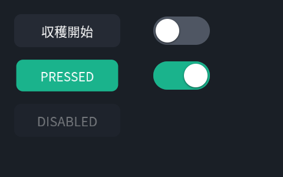
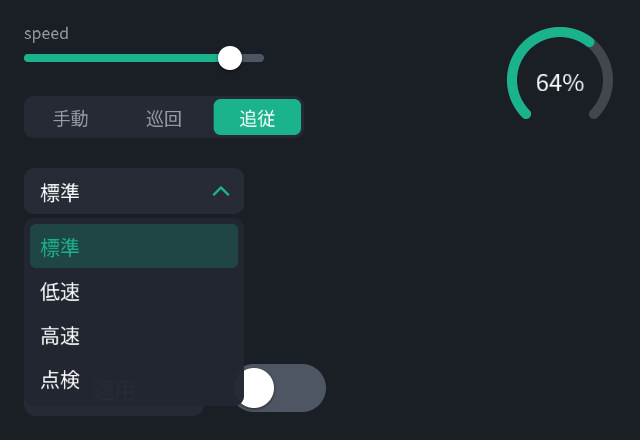

# Cookbook — やりたいこと別レシピ

全レシピは `Stage stage(1280, 720);` と `CpuRenderer renderer;` がある前提の
断片です。動く全体像は [examples/](../examples/) にあります
（すべてビルド・実行可能、CIで常時実行）。

## カメラ映像を全面に + PiP

```cpp
ImageView main_cam{1280, 720, main_pixels, 0};   // 借用: renderまで有効
ImageView rear_cam{640, 480, rear_pixels, 0};

stage.image(main_cam, Fit::Cover);                          // 全面
auto& pip = stage.image(rear_cam).frame({1000, 40, 240, 180})
                 .cornerRadius(10).border(2, Color::White).shadow();
// 毎フレームは差し替えだけ:
pip.setImage(rear_cam);
```

ポイント: `image()` は**ピクセルをコピーしません**。`ImageView` の指す
メモリは次の `render()` まで有効に保つこと。

## 画像の一部だけ切り出して貼る（部分コピー&ペースト）

```cpp
stage.image(cam).sourceRect({640, 200, 320, 240})   // 元画像のこの領域を
     .frame({40, 40, 640, 480});                    // ここへ拡大して貼る
```

`sourceRect` は**元画像のピクセル座標**です（0–1正規化ではない）。
同じソースを複数レイヤーで別々の `sourceRect` 参照してかまいません
（転送は1回、切り出しはサンプリングで行われます）。

## 経路（軌跡・計画パス）の表示

```cpp
auto& route = stage.polyline(path_points)
                   .thickness(6).dash(18)
                   .color(Color::Orange.faded(0.9f));
// 経路が更新されたら:
route.setPoints(new_points);
```

## HUD パネル（半透明の角丸 + テキスト）

```cpp
auto& hud = stage.group("hud").position(24, 24).opacity(0.9f).shadow();
hud.rect({0, 0, 340, 96}).cornerRadius(12).color({0, 0, 0, 0.45f});
hud.text("走行中", {16, 12}).size(28);
hud.text("SPEED 1.2 m/s", {16, 52}).size(22).color(Color::Teal);
```

ポイント: 裸の `group()` の `position` は**原点の移動**です（子は (0,0)
基準で書ける）。グループを中心回転・クリップ・背景付きにしたいときは
`bounds()` か `frame()` を明示してください。

## 影付きテキスト

```cpp
stage.text("収穫完了", {40, 40}).size(48).shadow(2, 3, 6);
```

影はレイヤーのシルエット（α）から生成されるので、テキストにも枠線にも
画像にもグループ全体にも同じ書き方で掛かります。

## 文字: 大きな数字・太字・縁取り（毎フレーム更新）

```cpp
Layer& speed = stage.text("0.0", {1200, 360}).size(180).bold().tabularNumbers()
                    .align(Align::Right).verticalAlign(VAlign::Middle)
                    .textOutline(6, {0, 0, 0, 0.7f});
// 毎フレーム:
speed.setText(fmt(v));   // 等幅数字なので桁が揺れない。字形はアトラスに残る
```

文字はどの大きさでもくっきり（小さい正立文字は画面ピクセルぴったりの
ビットマップ、大きい・回転・拡大は距離場）。詳細は
[docs/api/text.ja.md](api/text.ja.md)。

## 文字: 折返し・省略・自動縮小・リッチテキスト

```cpp
stage.text(body, {40, 40}).size(22).maxWidth(480).lineHeight(1.6f)   // 禁則つき折返し
     .maxLines(3).ellipsis();                                         // 3 行目で「…」
stage.text(title, {640, 40}).size(48).maxWidth(600).wrap(false)
     .autoFit(12).align(Align::Center);                               // 1 行に収まるまで縮小
TextSpan v{"88"}; v.size = 72; v.weight = 700;
stage.text("", {40, 600}).size(28).verticalAlign(VAlign::Baseline)
     .spans({TextSpan{"速度 "}, v, TextSpan{" km/h"}});               // ベースライン揃え
```

```yaml
- content: { text: { text: "とても長いタイトル", position: [640, 40], size: 48,
                     max_width: 600, wrap: false, min_size: 12, align: center } }
```

配置を自分で決めたいときは計測: `TextMetrics m = stage.textMetrics(layer);`
（JS は `fs_measure_text(inst, '{ text: "…", size: 64 }')` → JSON）。

## 文字: 装飾（グラデーション・発光・フォント）

```cpp
stage.text("グラデーション", {40, 300}).size(56).bold()
     .textGradient({0.3f, 0.9f, 1, 1}, {0.8f, 0.3f, 1, 1});        // 90° = 上→下
stage.text("NEON", {40, 200}).size(64).bold().glow(14, {1, 0.2f, 0.8f, 1});
stage.text("明朝体", {40, 400}).size(40).font("serif");
stage.text("斜体", {40, 460}).size(40).italic();                   // 斜体面が無ければ合成
registerFont("rounded", "/path/Rounded.ttf");                       // 好きなフォント
```

## 検出ボックス（ラベル + 時間平滑化）

```cpp
auto& det = stage.boxes({}).color(Color::Teal)
                 .cornerRadius(6).smoothing(0.2f);
// 認識結果が来るたび:
det.setBoxes(latest);     // Box{rect, score, label, id}
```

`smoothing` は時定数（秒）。`id` が入っていれば同一トラックへ、無ければ
最近傍で対応付けます。新規は目標位置に即出現、消失は即消滅（残像なし）。

## フィルタチェーン

```cpp
stage.image(cam).bilateral(4).contrast(1.2f);              // よく使う形
stage.image(cam).filter(Bilateral().radius(4).sigma_color(0.2f))
                .filter(ColorTransform().saturation(0.5f)); // 全種は型付き
```

長さ系パラメータ（`blur(4)` など）は論理単位です。元画像が VGA でも 4K
でも画面上で同じ見た目になります。グループに掛ければ合成後の1枚に
掛かります（グループぼかし）。

## アートフィルタ（絵画様式）

```cpp
stage.image(cam).filter(Anime());                            // セル画+線画
stage.image(cam).filter(Watercolor().wash(8).dilute(0.5f));  // 水彩
stage.image(cam).filter(Sumie().chroma(0.3f));               // 淡彩水墨
stage.image(cam).filter(Impressionist().stroke(10));         // 印象派筆致
stage.image(cam).filter(Stainedglass().size(30));            // ステンドグラス
stage.image(cam).filter(Pixelart().colors(4));               // ドット絵
```

どれもデフォルトで様式が出るよう調整済み。各様式の採用アルゴリズムと
パラメータ設計（何を 5 slot に残したか）は
[docs/design/art_filters.ja.md](design/art_filters.ja.md)。

## 生きている液体（liquid — 音声アシスタントの顔）

Kepler の "Liquid" を filter 1枚で描けます。不透明な `background` を
持つレイヤーに掛けると、その矩形の中で液体が下の絵の上に浮きます
(背景は透明)。`time` と `splash` は dt で自走するので、ホスト側の
ループは要りません。

```yaml
params:
  listen: { type: f32, default: 0, animate: { duration: 1.2, ease: ease_in_out } }
  think:  { type: f32, default: 0, animate: { duration: 1.2, ease: ease_in_out } }
  speak:  { type: f32, default: 0, animate: { duration: 1.2, ease: ease_in_out } }
  level:  { type: f32, default: 0 }
  splash: { type: f32, default: 9 }
layers:
  - frame: [0, 0, 1280, 720]
    background: [0, 0, 0, 1]
    filters:
      - liquid: { listen: $params.listen, think: $params.think,
                  speak: $params.speak, level: $params.level, splash: $params.splash }
```

```cpp
scene.setParam("speak", 1.0f);   // 気分は重み (残りが idle)。animate で混ざる
scene.setParam("level", mic);    // 声の大きさ 0–1
scene.setParam("splash", 0.0f);  // タップ: 経過秒を 0 から数え直す
```

ポインタは `pointer_x` / `pointer_y` (レイヤー座標) と `pointer` (存在
0–1)、色は `hue`、大きさは `size`、重さは `quality` で調整します。CPU は
quality < 0.75 のとき粗い格子で描きます。設計は
[design/liquid.ja.md](design/liquid.ja.md)、デモは `wasm/liquid.html`。

## メーター / ゲージ

```cpp
stage.arc({1180, 640}, 44, 120, 420).thickness(10).color({1, 1, 1, 0.25f});
auto& value_arc = stage.arc({1180, 640}, 44, 120, 120 + 3.0f * percent)
                       .thickness(10).color(Color::Teal);
stage.text("64%", {1180, 628}).size(24).align(Align::Center);

// 針: 下端中央を軸に回す
stage.rect({0, 0, 6, 90}).anchor(0.5f, 1.0f)
     .position(1180, 640).rotation(needle_deg).color(Color::Orange);
```

角度は度、0° = +x、画面上で時計回りです。

## 属性を変えるだけで滑らかに動かす

```cpp
{
    Transaction t(0.3f, Ease::InOut);
    stage.find("hud")->opacity(0.0f).position(24, -120);
}
// スコープ外の変更は即時。進行中の再変更は現在値から繋がる（ジャンプしない）。
```

## ボタンとスイッチ（UIコントロール）

```cpp
ui::Button start(stage.root(), {24, 900, 220, 64}, "収穫開始");
start.onTap([&] { robot.startHarvest(); });

ui::Switch light(stage.root(), {270, 908, 96, 48});
light.onChange([&](bool on) { robot.setLight(on); });

// 入力側の統合はこれだけ（Web/タッチ/VRすべて同じ3呼び出しに正規化）:
stage.pointerDown(pos);   // → pointerMove(pos) → pointerUp(pos)
```



コントロールは**新しい描画機構ではなくレイヤーのプレハブ**です（§10）。
状態=属性上書き（pressed → scale 0.96 + アクセント背景）で、遷移は
Transaction 経由なので自動で滑らかに動きます。見た目は `ButtonStyle` /
`SwitchStyle` で差し替え、配置は `control.layer()` を普通のレイヤーとして
操作。`enabled(false)` はポインタを**下のレイヤーへ素通し**します。

寿命の掟: コントロールのオブジェクトが挙動を持ち、レイヤーはStageが持ち
ます。反応させたい間はオブジェクトを生かしておくこと（破棄すると見た目は
残り、反応だけ消える）。見た目ごと消すのは `remove()`。

## スライダー・切替・ゲージ・プルダウン

```cpp
ui::Slider speed(stage.root(), {24, 44, 240, 28}, 0.35f);
speed.onChange([&](float v) { robot.setSpeedLimit(v); });   // ドラッグ中も連続で届く

ui::Segmented mode(stage.root(), {24, 96, 280, 42}, {"手動", "巡回", "追従"});
mode.onChange([&](int i) { robot.setMode(i); });

ui::Gauge battery(stage.root(), {560, 80}, 48);
battery.setValue(telemetry.battery01);   // 表示専用・即時反映

ui::Dropdown profile(stage.root(), {24, 168, 220, 46},
                     {"標準", "低速", "高速", "点検"});
profile.onChange([&](int i) { robot.setProfile(i); });
```



- **Slider** はドラッグ中ポインタに直結（遅延なし）、`setValue()` は
  アニメして到達。**Segmented** は2〜5択の排他選択 — 常に全択が見えるので
  タッチ/VRではプルダウンより誤操作が少ない
- **Dropdown** のポップアップは root 末尾のグループ（ツリー順=重なり順）+
  全面透明スクリム（外側タップで閉じる）。下に入りきらない時は上に開く。
  `max_visible`（既定8行）を超えるリストは**ドラッグでスクロール**
  （約6単位動いたらタップではなくドラッグと判定）。開いた時は選択行が
  見える位置までスクロール済み
- **Gauge** は表示専用。値の平滑化はテレメトリ側の仕事（ジャンプする
  ソースなら EMA を挟んでから `setValue`）

## ポインタの波紋（本物の水面屈折）

```cpp
fx::Ripple ripple(video_layer);    // このレイヤーが「水面」になる
                                   // （カメラ映像や背景グループを指す）

// 入力経路から（Webビューアのmousemove / タッチ / VRレイ）:
ripple.pointerMoved(pos);          // 軌跡に沿って波（間隔は自動間引き）
ripple.splash(pos);                // タップは強い波

// フレームループ（renderと同じdtを渡す = すべて決定的）:
ripple.tick(dt);
renderer.render(stage, dt);
```

各波は `fs_ripple` 屈折フィルタ（filters_shared.h の単一ソース、GPUでは
SPIR-Vとして実行）で、**下の映像のサンプリング位置を実際に歪ませます** —
拡大する波面の周りに減衰する正弦波。上に何かを描くのではありません。
座標は対象レイヤーのローカル論理座標（全面レイヤーならステージ座標その
まま）。`max_waves`（既定8、波1つ=フルスクリーンパス1回）で有界。
`RippleWave()` フィルタ単体でも使えます（ゲージの起動演出など）。

## どのレイヤーが押されたか（hit-test）

```cpp
if (Layer* hit = stage.hitTest({tap_x, tap_y})) {
    if (hit->id() == "start_button_bg") { /* ... */ }
}
```

判定は CALayer と同じ規則（ツリーの上から、transform考慮、hidden除外）。
ポインタ注入とUIコントロール（button/switch）は Phase L4 で載ります。

## 解像度を変えて出力する

```cpp
const Surface& preview = renderer.render(stage, 640, 360, dt);   // 同じ木
const Surface& full    = renderer.render(stage, 3840, 2160, dt); // 同じ木
```

描画は全て SDF なので、拡大してもビットマップ的な劣化はありません
（テキストのみアトラス拡大、SDF テキストは将来）。アスペクトが違うときの
方針は `stage.fit(Fit::Contain / Cover / Fill)`。

## YAML の画面を実行中に調整する（$params + animate）

Scene 文書に `params` を宣言し属性へ束縛すると、`setParam` 1回で束縛先が
まとめて変わります。`animate` を宣言しておけば **setParam が曲線で効く**
（§9 の implicit animation。宣言が無ければレイヤーの `transition`、
それも無ければ即時）:

```yaml
schema: fluent.scene/v1alpha2
params:
  hud_alpha: { type: f32, default: 1.0, runtime_mutable: true,
               animate: { duration: 0.3, ease: ease_in_out } }
layers:
  - id: hud
    opacity: $params.hud_alpha
    content: { rect: { size: [340, 96], color: [0, 0, 0, 0.45] } }
```

```cpp
compiled.scene->setParam("hud_alpha", 0.0f);   // 0.3s かけてフェードアウト
```

param の型は `f32 | vec2 | rect | color | bool`。配置も param で動かせます —
`scale` は f32 param なら縦横同率（`scale: 0.5` の糖衣と同じ）、vec2 なら
軸ごと。`frame` / `bounds` は rect param:

```yaml
params:
  zoom:  { type: f32, default: 1 }
  place: { type: rect, default: [40, 40, 640, 360],
           animate: { duration: 0.4, ease: ease_in_out } }
layers:
  - id: figure
    position: [960, 540]
    scale: $params.zoom
    transition: { duration: 0.4, ease: ease_in_out }   # zoom の変更も補間
  - id: media
    frame: $params.place                               # 位置と大きさを一度に
```

```cpp
scene.setParam("zoom", 0.3f);                          // 0.4s かけて縮む
scene.setParam("place", Rect{360, 40, 1520, 1000});    // 0.4s かけて広がる
```

色も param で塗り替えられます。content のスタイルキー（`color` /
`thickness` / `dash` / `corner_radius` …）と `border` / `shadow` の各フィールドは
`$params` を受け付け、色は `transition` / `animate` で補間されます —
モードごとに色違いのレイヤーを重ねて opacity で切り替える必要はありません:

```yaml
params:
  tint: { type: color, default: [0.47, 0.59, 1, 1],
          animate: { duration: 0.5, ease: ease_in_out } }
layers:
  - content: { polyline: { source: $inputs.wave, color: $params.tint, thickness: 2.5 } }
  - frame: [0, 0, 148, 148]
    border: { width: 2, color: $params.tint }
```

```cpp
scene.setParam("tint", Color{1.0f, 0.7f, 0.3f, 1});   // 0.5s かけて橙へ
```

レイアウト遷移のたびに文書を作り直す必要はありません。`transform`
(行列) は補間されないので、動かしたい配置は position + scale (+ anchor)
か frame/bounds で書くのが正解です。

## 実行中にレイヤーを足す・消す（addLayers / removeLayer）

写真やグラフを出し入れするたびに文書を作り直す必要はありません。ホスト
文書に**枠グループ**を置いておき、そこへ Scene 断片を足します。走っている
アニメーションや給餌済みの input はそのまま:

```yaml
# ホスト文書
layers:
  - id: media                      # 出し入れする中身の置き場（重なり順もここで決まる）
    frame: [360, 40, 1520, 1000]
    transition: { duration: 0.35, ease: ease_out,
                  enter: { opacity: 0, scale: 0.92 },   # 現れ方
                  exit: { opacity: 0 } }                # 消え方
  - id: figure                     # 常に手前
```

```cpp
// 断片: layers は必須、自前の inputs / params を宣言してよい（同名は同一宣言のみ可）
auto r = scene.addLayers("media", R"(
inputs: { photo: { type: image.rgba8, fallback: hide } }
layers:
  - id: photo
    content: { image: { source: $inputs.photo, fit: contain } }
)", /*animated=*/true);              // media の transition で現れる
if (!r.ok()) { /* r.diagnostics — シーンは呼ぶ前のまま */ }
scene.setImage("photo", view);

scene.removeLayer("photo", /*animated=*/true);   // 消えていく。id はすぐ空く
scene.layerIds();                                 // {"media", "figure"}
```

C++ でレイヤーを直接消すときの「消えてから外す」は
`{ Transaction t(0.3f); card.opacity(0); } card.removeWhenSettled();`。

## AI に画面を書かせる（describe → validate → preview）

```bash
./build/fvsc describe --json   # このビルドの全語彙: content/属性/フィルタ/型/上限
./build/fvsc validate scene.fvs --strict   # 型検査 + デザインリンター（警告も失敗に）
./build/fvsc preview scene.fvs -o check.ppm
```

リンター（§13-2）は「正しいが悪い」画面を警告します: テキストの
コントラスト比 4.5:1 未満（**実際に描いた背景ピクセル**に対して測定）、
宣言 bounds からのテキストはみ出し、後段の不透明レイヤーによる完全遮蔽
（`protected: true` の遮蔽はエラー）、キャンバス外配置。生成 → validate →
直す、のループがそのまま品質ループになります。

## YAML で UI を宣言する（L4）

```yaml
schema: fluent.scene/v1alpha2
params:
  light: { type: bool, default: false }
layers:
  - id: start
    frame: [24, 440, 220, 64]
    content: { button: { label: "収穫開始" } }
  - id: lamp
    frame: [270, 450, 96, 48]
    content: { switch: { on: $params.light } }   # setParam が状態を駆動
```

```cpp
compiled.scene->onUiEvent([](const fs::UiEvent& e) {
    // e.id = "start", e.control = "button" — topic に流すのも自由
});
compiled.scene->stage().pointerDown(p);   // 入力はポインタ注入(§10-3)
```

scene_web はこれを全部配線済み: ブラウザのクリック→/pointer→注入、
イベント→/status と `--events /topic`。

## 既知の L0 制限（正直リスト）

- `dash()` が効くのは line / polyline / polygon枠線。arc の破線は未対応
- arc の `Cap::Butt` は未対応（丸キャップで描画）
- 縁取りの幅は約 0.17 × 文字サイズまで（距離場の範囲）
- フィルタの色は sRGB 空間で計算（リニア化は L1 検討）
- 裸のグループに `masksToBounds` / `background` を付けても bounds がゼロの
  ため何も起きない — `bounds()` を明示すること
- レイヤー単位のホバー状態（ボタンのhover強調等）は未実装 — ポインタ注入
  は capture 中の Move のみルーティングする（波紋のような画面エフェクトは
  fx::Ripple に位置を直接流すので影響なし）
